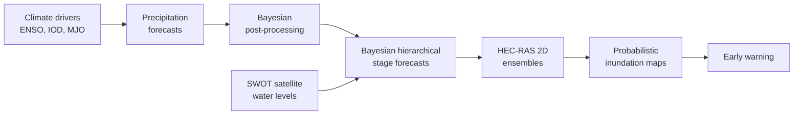

  

  
  
  

---

I am a PhD researcher in Civil, Environmental and Architectural Engineering at the **University of Colorado Boulder (CIRES)**, advised by Prof. Balaji Rajagopalan. I build **probabilistic flood forecasting and early warning systems** for data-scarce, flood-prone river basins, with the Brahmaputra as my main testbed.

My work sits where **statistics, probability and hydrology** meet: Bayesian hierarchical models, causal networks, satellite observations and hydraulic simulation, combined into forecasts that carry honest uncertainty all the way to the flood map.

**Dissertation:** *Bayesian Hierarchical and Causal Network Based Models for Riverine Flood Risk Warning and Assessment*

## 🌊 The forecasting chain I work on

## 🔬 Research

| Theme | What it does | Methods |
|---|---|---|
| **BRACE** | Reconstructs continuous daily river water surface elevation from sparse SWOT satellite overpasses | Bayesian hierarchical nonstationary models, Stan |
| **Causal drivers of streamflow** | Finds which climate modes drive monsoon streamflow in the Brahmaputra | Bayesian causal networks, do-calculus, Exploratory Graph Analysis |
| **Precipitation post-processing** | Corrects space-time precipitation forecasts in the Brahmaputra and Narmada basins | Bayesian hierarchical spatial models |
| **Probabilistic inundation mapping** | Turns stage forecast ensembles into flood depth and exceedance probability maps around Guwahati | HEC-RAS 2D ensembles, terra |
| **Real-time flood warning** | Operational Brahmaputra forecasts from gauge-linked precipitation to inundation | Automated data pipelines, land surface model forecasts |

## 📄 Selected publication

- **Rastogi, N. K.**, Nanditha, J. S., & Rajagopalan, B. (2026). Bayesian Causal Networks for streamflow variability in the Brahmaputra River Basin. *Earth's Future*. [doi:10.1029/2026EF008056](https://doi.org/10.1029/2026EF008056)

## 🛠️ Tools

  
  
  
  
  
  
  

## 🏅 Recognition

- 2026 CIRES Graduate Student Research Award
- Primary convener, AGU Fall Meeting 2026 Session H096
- President, CU Boulder AWRA Student Chapter and Water Buffs (2026 to 2027)

---

<i>Open to collaborations on flood forecasting, Bayesian hydrology and SWOT applications.</i>

